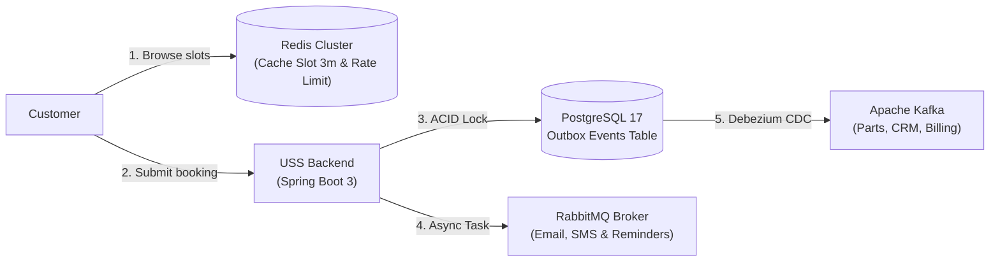

# Future Features & System Extensibility Roadmap (Future Roadmap)
> **Focus**: Problem Statement $\to$ Concrete Solution & Technology (What Solves What).

---

## 1. Customer-Centric Booking Governance

| Operational Problem | Architectural Solution |
| :--- | :--- |
| **Users hoard slots across days and cancel last minute** | **Active Quotas**: Limit retail customers to a maximum of 2–3 active `CONFIRMED` appointments. |
| **Unannounced customer no-shows waste bay/tech capacity** | **Trust Score (0–100)**: No-shows deduct points; falling below 50 requires upfront pre-payment/deposit. |
| **Late cancellations leave idle shop capacity** | **Cut-Off Windows**: Free cancellation allowed up to 4h/24h. Late cancellations are flagged to deduct trust points. |
| **Booking random VINs belonging to others** | **Vehicle Ownership Verification**: Table `customer_vehicles` validates ownership before confirming appointments. |

---

## 2. Multi-Dealership Floating Technicians

| Operational Problem | Architectural Solution |
| :--- | :--- |
| **High-voltage EV specialists are too costly to station permanently at every branch** | **N-to-N Shift Schedules (`technician_shifts`)**: Technicians rotate across branches (Mon/Wed/Fri at Metro, Tue/Thu/Sat at West). |
| **Transit delays when traveling between branches** | **Travel Time Buffers**: Inserts an automatic 60–90 minute transit window, locking out appointments while `TRAVELING`. |
| **Risk of concurrent bookings across different branches** | **Global Pessimistic Locking**: `SELECT ... FOR UPDATE` directly locks the technician's primary key, serializing multi-branch requests in the DB queue. |

---

## 3. Master Data Administration Subsystem (Admin CRUD APIs)

| Operational Problem | Architectural Solution (Admin REST APIs + RBAC) |
| :--- | :--- |
| **No UI/API to manage branches without manual SQL** | `POST/PUT /api/v1/admin/dealerships`: Adjust operating hours and maintenance closures $\to$ immediately closes all downstream slots. |
| **Lift bay mechanical breakdown or inspection** | `PUT /api/v1/admin/service-bays/{id}/status`: Set `is_operational = false` $\to$ automatically alerts advisors to reassign impacted vehicles to free bays. |
| **New technician onboarding or sudden sick leave** | `POST /api/v1/admin/technicians` & `PUT .../leave`: Update certifications (`SkillCode`) or sick leave $\to$ triggers automated reassignment workflows. |
| **Introducing new service offerings** | `POST/PUT /api/v1/admin/service-types`: Configure standard durations and prerequisite certification requirements. |

---

## 4. Omnichannel Notification Subsystem

| Operational Problem | Architectural Solution |
| :--- | :--- |
| **Customers forget appointment time or assigned staff** | **Automated Email/SMS**: Sends booking confirmation with a check-in QR code, plus automated 24h & 2h SMS reminders. |
| **Technicians unaware of upcoming vehicle arrival** | **Technician Mobile Push**: Dispatches instant push notifications when assigned or reassigned to a repair order. |
| **Sending notifications blocks or fails database commits** | **Asynchronous Decoupling (`AFTER_COMMIT`)**: DB commit succeeds first (<50ms), then hands off notification tasks to a background thread pool (`@Async`). |

---

## 5. Concrete Architectural Roles: Redis, RabbitMQ & Apache Kafka

| Technology | Architectural Placement | Operational Problem | Concrete Solution |
| :--- | :--- | :--- | :--- |
| **Redis** | In front of **PostgreSQL** (Ingress Cache) | Slot discovery queries outnumber bookings 100:1, overwhelming database I/O. | - **Cache 30-minute slot grids** (TTL 3 mins); auto-evicted on new bookings. - **Token Bucket Rate Limiting**: Throttles bot abuse. - **Fast Contention Guard**: Eliminates 19/20 competing requests in RAM before touching DB pools. |
| **RabbitMQ** | Alongside **Service Layer** (Task Queue) | Third-party notification APIs (Twilio, SendGrid) take 1–3s and suffer network drops. | - **Asynchronous Task Queue**: Offloads jobs to background workers; auto-retries failures via Dead-Letter Queue (DLQ). - **Delayed Reminders**: Uses *Delayed Exchange* to trigger 24h & 2h reminders without polling cron jobs. |
| **Apache Kafka** | At the **Enterprise Boundary** (Event Mesh) | Need to notify Parts, Billing, and CRM without tight service coupling. | - **Transactional Outbox Pattern + Debezium CDC**: Streams lifecycle events directly from DB logs to Kafka: &nbsp;&nbsp;• *Parts Inventory*: Automatically reserves/releases parts. &nbsp;&nbsp;• *Billing*: Creates preliminary Repair Orders (RO). &nbsp;&nbsp;• *CRM*: Accrues loyalty points and sends CSAT surveys. - **Real-Time Analytics**: Feeds contention data to Flink/Spark for dynamic demand-based pricing. |
