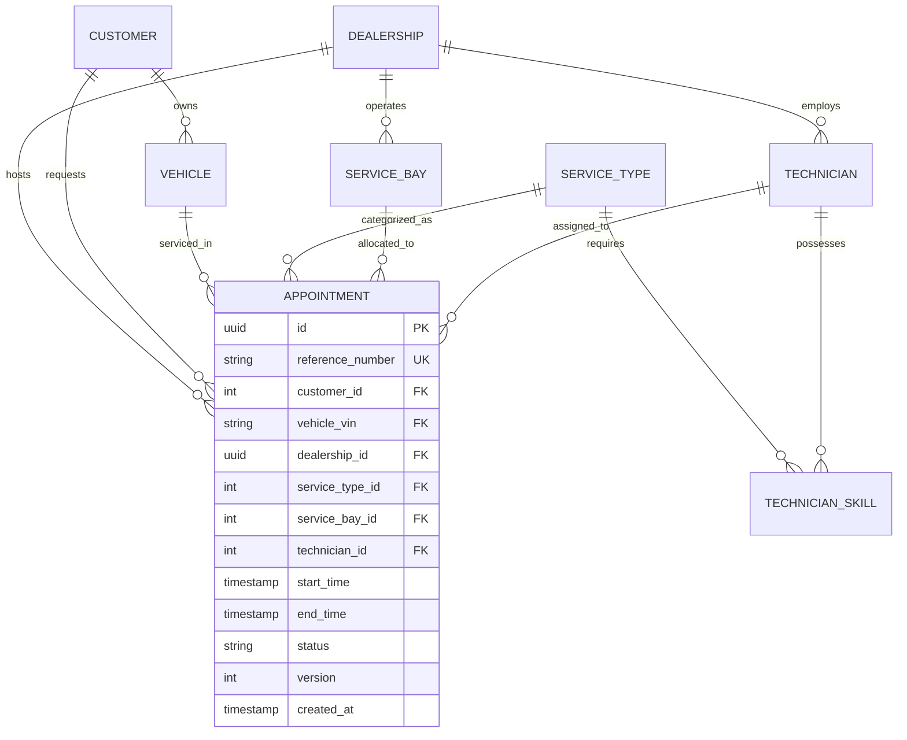

# The Unified Service Scheduler - Software Requirements Specification (SRS)

## 0. Original Requirement

> - **Domain**: Ownership
> - **Task**: Build an Appointment Scheduler application to replace manual booking systems.
> - **Core Requirements**:
>   1. **Resource Constrained Booking**: Allow a user to request a service appointment for a specific vehicle, service type, and dealership at a desired time.
>   2. **Real-Time Availability Check**: Before confirming, check for the availability of both a ServiceBay and a qualified Technician for the entire service duration.
>   3. **Confirmed Appointment Record**: Upon success, create a persistent Appointment record associating the customer, vehicle, technician, and service bay.

---

## 1. Executive Summary & Context
- **System Name**: The Unified Service Scheduler (USS)
- **Domain**: Ownership (Automotive Service & Dealership Management)
- **Problem Statement**: Traditional dealerships rely on fragmented, manual, or phone-based service booking processes. This leads to inefficient bay utilization, scheduling conflicts, mismatching technicians' skills with service requirements, customer wait times, and high administrative overhead.
- **Goal**: Deliver a robust, production-grade, highly reliable Backend Service that automates resource-constrained service appointment scheduling, ensures zero double-booking through atomic concurrency control, and persists complete audit trails for dealership operations.

---

## 2. Core Functional Requirements (FR)

### FR-1: Resource-Constrained Booking Request
- **Description**: Customers or service advisors can request an appointment for a specific vehicle, desired service type, dealership location, and preferred time slot.
- **Inputs**:
  - `customerId`: Unique customer identifier.
  - `vehicleVin`: Vehicle Identification Number (or license plate + make/model/year).
  - `dealershipId`: Specific service center / dealership branch.
  - `serviceTypeId`: Type of service (e.g., Oil Change, Brake Inspection, Major Maintenance, EV Battery Diagnostic).
  - `requestedStartTime`: Desired ISO-8601 start timestamp.
- **Service Duration & Requirements**:
  - Each `ServiceType` specifies an estimated standard duration (e.g., 30 mins, 60 mins, 120 mins).
  - Each `ServiceType` specifies mandatory skill qualifications (e.g., `BRAKE_CERTIFIED`, `EV_SPECIALIST`, `GENERAL_MAINTENANCE`).

### FR-2: Real-Time Multi-Resource Availability Check
- **Description**: Before confirming any booking, the scheduling engine must verify simultaneous availability for the entire duration of the service across two constrained physical/human resources:
  1. **ServiceBay**: An available service stall at the specified dealership suitable for the vehicle/service.
  2. **Qualified Technician**: An active technician employed at the dealership who:
     - Possesses the required skill certification for the selected `ServiceType`.
     - Has no conflicting appointments or scheduled breaks during `[requestedStartTime, requestedStartTime + duration)`.
     - Operates within standard working hours / shifts.
- **Slot Discovery API**:
  - Users can query available time slots for a given dealership, service type, and date range (`/api/v1/schedules/available-slots`).
- **Conflict & Concurrency Guarantee**:
  - If multiple concurrent requests target the same slot/technician/bay, the system MUST prevent double-booking using transactional isolation and pessimistic/optimistic locking with atomic check-and-reserve semantics.

### FR-3: Confirmed Appointment Record & Persistence
- **Description**: Upon successful validation and resource allocation, create a persistent, immutable appointment record.
- **Attributes Persisted**:
  - `appointmentId`: UUID identifier.
  - `referenceNumber`: Human-readable confirmation code (e.g., `APT-20261025-XXXX`).
  - `dealershipId`, `customerId`, `vehicleVin`.
  - `serviceTypeId`, `startTime`, `endTime`, `durationMinutes`.
  - `allocatedServiceBayId`.
  - `assignedTechnicianId`.
  - `status`: `CONFIRMED`, `IN_PROGRESS`, `COMPLETED`, `CANCELLED`, `RESCHEDULED`.
  - `createdAt`, `updatedAt`, `version` (for optimistic locking / audit).
- **Audit History**: Status transitions are logged to an audit table with timestamp and reason.

### FR-4: Appointment Lifecycle Management
- **Description**: Support full lifecycle operations:
  - **Get Details**: Retrieve appointment by ID or reference code.
  - **Cancel Appointment**: Release allocated bay and technician back to the availability pool; update status to `CANCELLED`.
  - **Reschedule Appointment**: Atomically verify new slot availability, reallocate resources, and update appointment.
  - **Search & Filter**: List appointments by customer, vehicle VIN, dealership, date range, or status.

---

## 3. Non-Functional Requirements (NFR)

### NFR-1: Data Consistency & Concurrency Protection
- **Zero Double-Booking**: Under high-concurrency race conditions (e.g., 50 simultaneous requests for the last available slot), exactly one request must succeed and others must receive clear conflict errors (HTTP 409 Conflict).
- **ACID Transactions**: Resource allocation (Bay + Technician + Appointment creation) is executed inside a strict `@Transactional` boundary.

### NFR-2: Performance & Scalability
- **Latency**: P95 response time < 150ms for availability checks; P95 < 200ms for booking confirmation.
- **Throughput**: Designed for horizontal scalability with stateless application tier.
- **Database Indexing**: Optimized composite indexes on `(dealership_id, start_time, end_time)` and technician/bay schedules.

### NFR-3: Observability & Health Monitoring
- **Structured Logging**: JSON logging with Slf4j / Logback including `traceId`, `spanId`, and business context (`dealershipId`, `appointmentId`).
- **Metrics**: Spring Boot Actuator with Micrometer exposing Prometheus metrics:
  - Total bookings created / rejected.
  - Booking latency distribution.
  - Resource utilization rates (Bay occupancy, Technician workload).
- **Tracing**: W3C Trace Context propagation ready for OpenTelemetry.
- **Health Checks**: Read-only liveness and readiness probes (`/actuator/health`).

### NFR-4: Error Handling & API Standards
- **RFC 7807 Problem Details**: Standardized error payloads with `type`, `title`, `status`, `detail`, `instance`, and field-level validation errors.
- **HTTP Status Codes**:
  - `201 Created`: Appointment successfully booked.
  - `200 OK`: Successful query/update.
  - `400 Bad Request`: Input validation failed (invalid VIN, past date, etc.).
  - `404 Not Found`: Dealership, service type, or appointment not found.
  - `409 Conflict`: Resource unavailable / slot clash.
  - `422 Unprocessable Entity`: Business rule violation (e.g., technician not certified).

---

## 4. Domain Model & Entities

---

## 5. Acceptance Criteria (AC)

- [ ] **AC-1**: API allows querying available slots for a dealership + service type within a date range, taking bay capacity and technician skills into account.
- [ ] **AC-2**: Submitting a valid booking request for an available slot creates a confirmed appointment with an assigned bay and qualified technician.
- [ ] **AC-3**: Requesting an appointment when all bays are full returns `409 Conflict` with a descriptive error.
- [ ] **AC-4**: Requesting an appointment when no technician with required qualifications is free returns `409 Conflict`.
- [ ] **AC-5**: Concurrent booking requests for the exact same resource slot result in at most 1 confirmation; zero double-booking occurs.
- [ ] **AC-6**: Cancelled appointments immediately free up both the bay and technician for subsequent bookings.
- [ ] **AC-7**: Complete OpenAPI 3.0 documentation available via Swagger UI (`/swagger-ui.html`).
- [ ] **AC-8**: Comprehensive automated test suite (Unit + Integration + Concurrency tests) passes with high code coverage (>80%).
