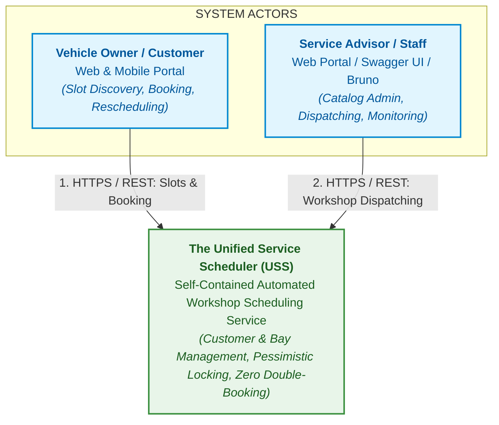
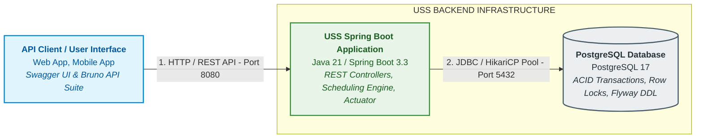
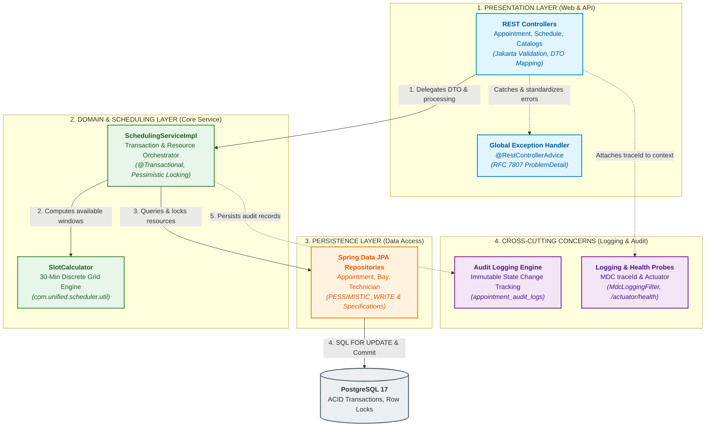
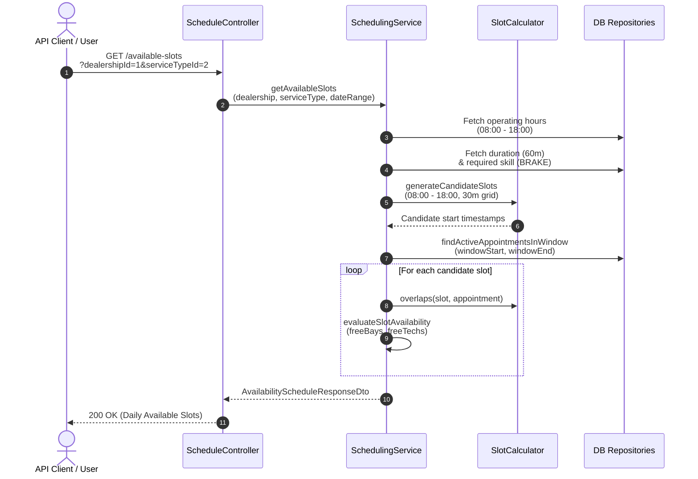
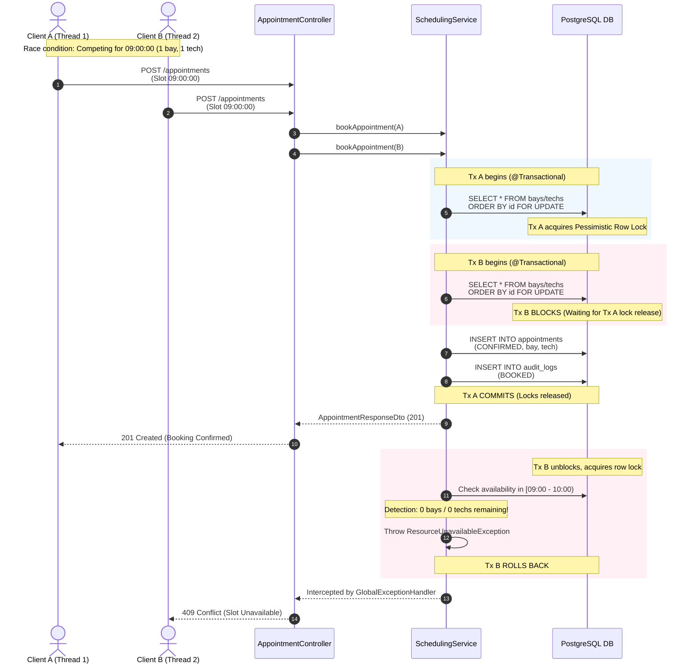
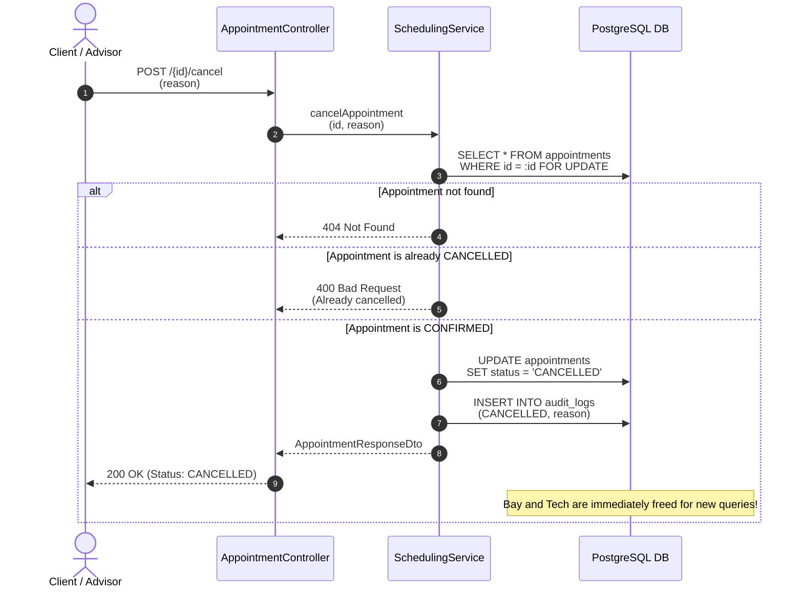
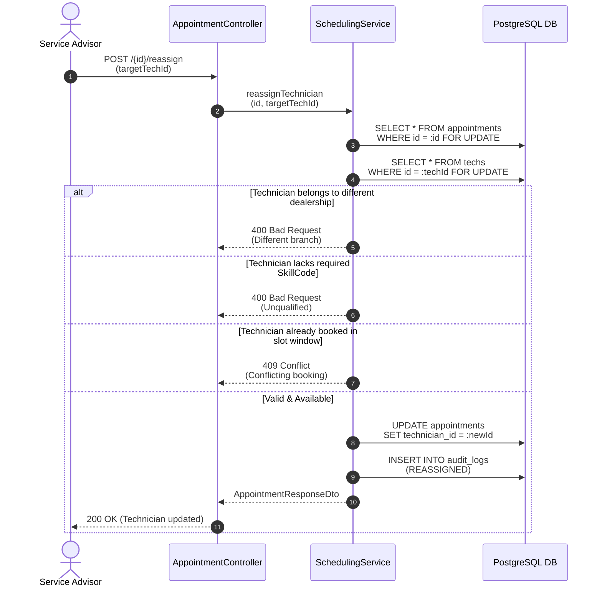
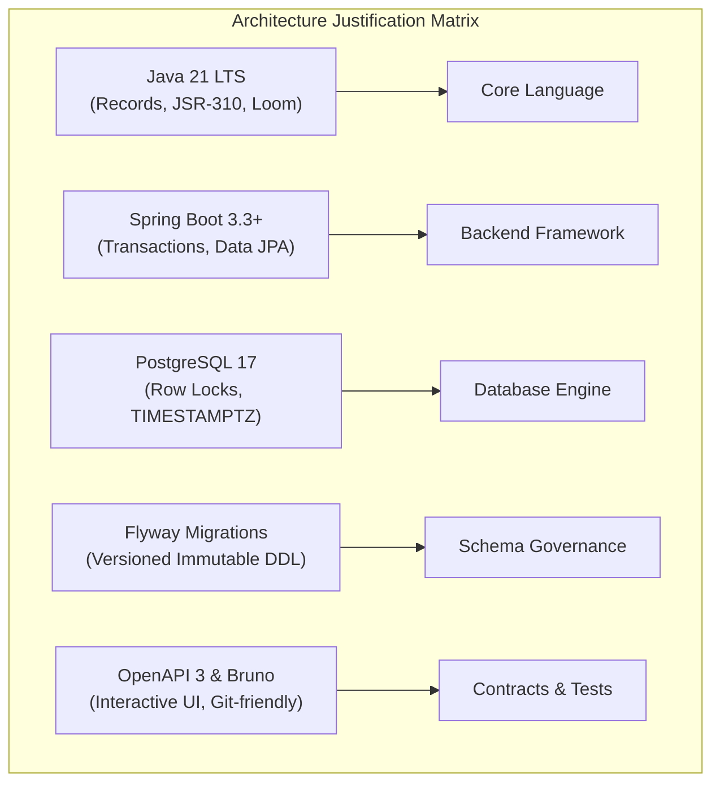
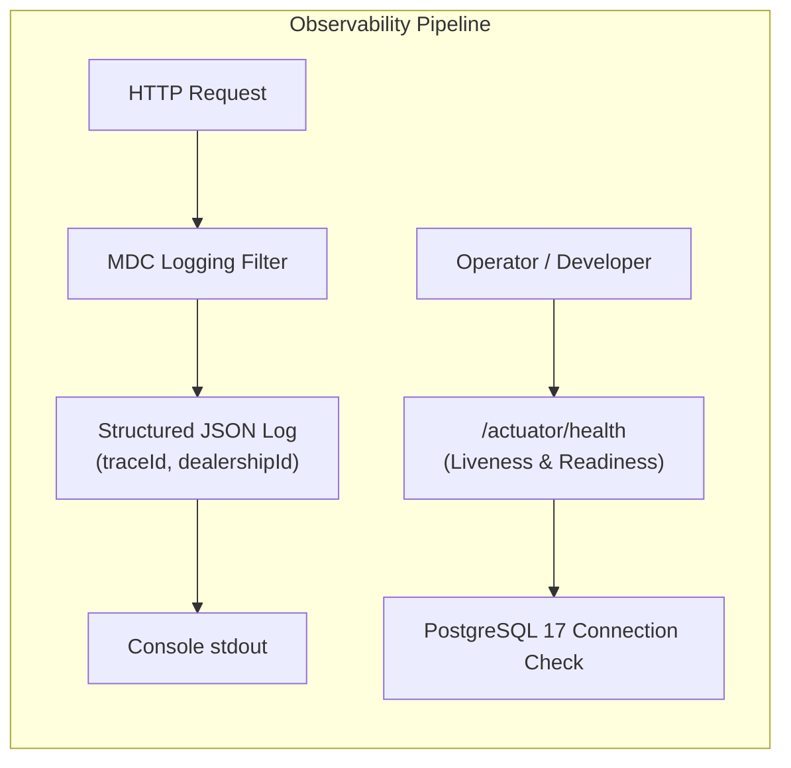
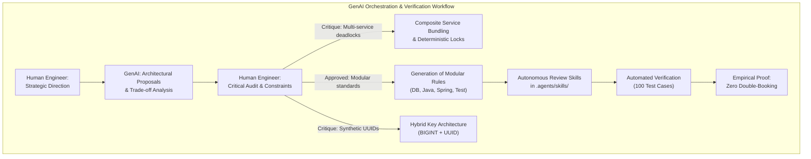

# System Design Document: The Unified Service Scheduler (USS)

**Document Version**: 1.0  
**Domain**: Ownership (Automotive Service & Dealership Network)  
**Author**: Systems Architecture & AI Engineering Team  
**Evaluation Scope**: Keyloop Technical Assessment - Scenario A  

---

## 1. Executive Summary & Problem Framing

### 1.1. Context & Business Problem
Traditional automotive dealerships rely on fragmented, manual, or phone-based service booking processes. This operational friction results in:
- Inefficient physical service stall (bay) utilization and idle downtime.
- Incompatible technician assignment (e.g., assigning a technician without high-voltage electrical certification to perform an EV battery diagnostic).
- Double-booking conflicts under concurrent customer booking rushes.
- Lack of immutable audit trails for appointments and vehicle ownership histories.

### 1.2. System Mission
**The Unified Service Scheduler (USS)** is a resilient, enterprise-grade backend service designed to automate resource-constrained scheduling. The system enforces strict multi-resource availability rules: an appointment is only confirmed when **both** an eligible physical **Service Bay** AND an active **Qualified Technician** are simultaneously vacant and locked for the entire duration of the requested service.

---

## 2. System Architecture & Diagrams

The system architecture is modeled using the **C4 Architectural Model** (Context, Container, Component).

### 2.1. Level 1: System Context Diagram
The System Context diagram illustrates how USS interfaces directly with real-world users, reflecting its self-contained architecture:



---

### 2.2. Level 2: Container Diagram (Backend Infrastructure)
The Container diagram illustrates the actual technical boundaries between API clients, the Spring Boot application container, and the PostgreSQL database:



---

### 2.3. Level 3: Component Diagram (Spring Boot Internal Architecture)
The Component diagram depicts the internal modularity and strict one-way layered architecture inside the Spring Boot application container:



---

## 3. Component Roles & Responsibilities

| Component Name | Primary Architectural Responsibility | Key Classes / Interfaces |
| :--- | :--- | :--- |
| **REST Controller Layer** | Handles incoming HTTP requests, enforces Jakarta Bean Validation (`@Valid`), delegates to the service layer, and maps internal records to API response DTOs. Never interacts directly with database repositories. | `AppointmentController`, `ScheduleController`, `DealershipController`, `ServiceTypeController` |
| **Global Exception Handler** | Intercepts all unchecked exceptions, domain failures, and validation errors. Formats every error as an RFC 7807 `ProblemDetail` document with machine-readable metadata. | `GlobalExceptionHandler`, `BusinessException`, `ResourceUnavailableException` |
| **Scheduling Engine** | Core orchestrator of business logic. Coordinates availability calculation across multi-resource constraints (bays + technicians), triggers atomic row locks, and commits appointments. | `SchedulingService`, `SchedulingServiceImpl` |
| **Slot Calculator** | Deterministic mathematical utility that divides dealership operating hours into standard 30-minute grid increments and evaluates resource overlap matrices. | `SlotCalculator` |
| **Persistence & Repository Layer** | Interfaces with PostgreSQL 17 via Spring Data JPA. Contains custom JPQL and native queries using `PESSIMISTIC_WRITE` locks to serialize competing transactions. | `AppointmentRepository`, `TechnicianRepository`, `ServiceBayRepository` |
| **Audit & Event Engine** | Records immutable historical state transitions (`CONFIRMED`, `CANCELLED`, `RESCHEDULED`) into `appointment_audit_logs` for compliance and operational transparency. | `AppointmentAuditLog`, `AppointmentEventListener` |
| **Logging & Health Probes** | Structured JSON logging with Slf4j/Logback MDC `traceId` correlation and Spring Boot Actuator `/actuator/health` probes. | `MdcLoggingFilter`, Spring Boot Actuator |

---

## 4. End-to-End Data Flow & Sequence Diagrams

### 4.1. Sequence 1: Real-Time Multi-Resource Slot Discovery
*Scenario*: A customer searches for available appointment slots at Dealership $D$ for Service Type $S$ over a Date Range $[T_1, T_2]$.



---

### 4.2. Sequence 2: Atomic Multi-Resource Booking & Concurrency Protection
*Scenario*: Multiple concurrent requests attempt to reserve the exact same remaining bay/technician slot at 09:00:00.



---

### 4.3. Sequence 3: Appointment Cancellation & Resource Liberation
*Scenario*: An appointment is cancelled by the customer or advisor, immediately restoring resource capacity.



---

### 4.4. Sequence 4: Technician Reassignment & Conflict Guard
*Scenario*: A service advisor manually reassigns a technician to a confirmed appointment, enforcing dealership matching, skill eligibility, and slot conflict checks.



---

## 5. Technology Choices & Detailed Justifications



### 5.1. Language & Runtime: Java 21 LTS - Practical Features Utilized in USS

The selection of **Java 21 LTS** as the core backend runtime is directly justified by the modern language features actively utilized across the USS codebase:

1. **Java Records (`record` - JEP 395) - 100% Request/Response DTOs & Internal Value Objects**:
   - Employed across all 21 DTO and value object files in the project (e.g. `BookAppointmentRequest`, `AppointmentResponseDto`, `AvailableSlotDto`, `DateRange`, `AllocatedResources`).
   - **Absolute Immutability**: All fields are implicitly `final`, eliminating data leakage or accidental state mutations across architectural layers and concurrent threads.
   - **Immutable DTO Standardization**: Native compiler-generated canonical constructors, getters, `equals()`, `hashCode()`, and `toString()`, ensuring API contracts remain strictly immutable without annotations; while Project Lombok is disciplined strictly to `@Getter` and `@Setter` on JPA entities.

2. **Sequenced Collections (`getFirst()` & `getLast()` - JEP 431) - Window Boundary Derivation**:
   - Applied directly in `SchedulingServiceImpl.java` to extract candidate appointment boundaries:
     ```java
     OffsetDateTime windowStart = slots.getFirst();
     OffsetDateTime windowEnd = slots.getLast().plusMinutes(durationMinutes);
     ```
   - Replaces error-prone index arithmetic (`slots.get(0)`, `slots.get(slots.size() - 1)`) with expressive, readable, and bounds-safe collection semantics.

3. **JSR-310 Modern Date/Time API (`java.time`) - Multi-Timezone Temporal Scheduling**:
   - Forms the mathematical foundation across 18 source files (particularly `SlotCalculator` and `SchedulingServiceImpl`):
     - `OffsetDateTime`: Normalized ISO-8601 UTC storage and interval arithmetic matching PostgreSQL 17 `TIMESTAMPTZ`.
     - `LocalTime` & `LocalDate`: Dealership operating window management (`openingTime`, `closingTime`) for discrete 30-minute grid generation.
     - `ZoneId`: Projects UTC timestamps to the dealership's specific regional timezone (`ZoneId.of(dealership.getTimeZone())`), ensuring Daylight Saving Time (DST) resilience.

4. **Stream API `toList()` (Java 16+) - Concise & Unmodifiable Collections**:
   - Used across service implementations (`CustomerServiceImpl`, `DealershipServiceImpl`, `ServiceBayServiceImpl`, `ServiceTypeServiceImpl`, `TechnicianServiceImpl`):
     ```java
     return repository.findAll().stream()
         .map(this::toDto)
         .toList();
     ```
   - Replaces verbose `.collect(Collectors.toList())`, directly returning an unmodifiable list to prevent downstream mutation bugs.

5. **Enhanced `Optional` Functional Idioms - Expressive Domain Error Handling**:
   - Leverages `Optional.orElseThrow(...)`, `Optional.map(...)`, and `Optional.filter(...)` throughout `SchedulingServiceImpl` to fail-fast on missing resources, cleanly throwing `BusinessException` and `ResourceUnavailableException` without nested null checks.

### 5.2. Framework: Spring Boot 3.3+
- **Chosen**: Spring Boot 3.3.x on Spring Framework 6.x.
- **Justification**:
  - **Declarative Transaction Management (`@Transactional`)**: Seamless boundaries controlling database lock acquisition, rollback semantics, and commit lifecycles.
  - **Spring Data JPA**: Expressive repository interfaces combined with native lock annotation `@Lock(LockModeType.PESSIMISTIC_WRITE)`.
  - **Spring Boot Actuator & Micrometer**: Out-of-the-box production readiness with zero custom plumbing for metrics, health checks, and tracing.

### 5.3. Database Engine & Pragmatic Hybrid Key Architecture: PostgreSQL 17
- **Chosen**: PostgreSQL 17 with a **Hybrid Primary Key Strategy**.
- **Architectural Justification**:
  - **Master & Reference Catalog Data (`BIGINT IDENTITY`)**: Catalog tables (`dealerships`, `service_types`, `service_bays`, `technicians`, `technician_skills`) use `BIGINT GENERATED BY DEFAULT AS IDENTITY PRIMARY KEY` combined with natural business unique keys (e.g. `uk_dealerships_code`).
    - *Storage Efficiency*: 8 bytes per FK instead of 16 bytes, cutting composite B-Tree index sizes on high-frequency scheduling lookup indexes (`(service_bay_id, start_time, end_time)` and `(technician_id, start_time, end_time)`) by up to 50%.
    - *Seed & Migration Maintainability*: Eliminates awkward synthetic UUID constants (`11111111-1111...`) in seed scripts; foreign keys resolve naturally via standard ANSI SQL subqueries `(SELECT id FROM dealerships WHERE code = 'DLR-METRO')`.
  - **Transactional Domain Data (`UUID`)**: Highly sensitive business entities (`appointments`, `appointment_audit_logs`) use `UUID PRIMARY KEY` (`DEFAULT gen_random_uuid()`).
    - *Anti-Enumeration & Security*: Prevents IDOR (Insecure Direct Object Reference) vulnerabilities and prevents external scraping or competitor enumeration of dealership booking volumes.
    - *Distribution Readiness*: Enables decentralized ID generation and horizontal scalability across future microservices.
  - **ACID Strictness & Row-Level Locking**: High-performance support for `SELECT ... FOR UPDATE`, guaranteeing serializable reservation behavior without deadlocking entire tables.
  - **Timezone Precision**: Standard `TIMESTAMP WITH TIME ZONE` (`TIMESTAMPTZ`) for unambiguous multi-location dealership scheduling across regional timezones.
- **Alternatives Evaluated**:
  - *Pure UUID Everywhere*: Rejected due to high B-Tree page fragmentation, 2x foreign key storage overhead in appointment composite indexes, and awkward seed migration ergonomics.
  - *Pure Auto-Increment BIGINT Everywhere*: Rejected for `appointments` due to severe security vulnerabilities (predictable IDs expose customer volume and invite enumeration attacks).
  - *MongoDB*: Document stores lack multi-row ACID locks across separate collections (bays, technicians, appointments), creating critical race conditions and risk of double-booking.

### 5.4. Schema Versioning: Flyway
- **Chosen**: Flyway Database Migrations (`flyway-core`, `flyway-database-postgresql`).
- **Justification**:
  - Enforces version-controlled, immutable database evolution (`V1__init_schema.sql`, `V2__seed_data.sql`).
  - Guarantees complete environmental parity between local development, testing, and production.
  - Avoids dangerous Hibernate `ddl-auto: update` behaviors.

### 5.5. Client Verification & Contract: OpenAPI 3.0 & Bruno
- **Chosen**: Springdoc OpenAPI (Swagger UI) + Bruno Collection (`bruno/`).
- **Justification**:
  - **OpenAPI 3.0**: Provides an interactive browser console at `/swagger-ui.html` for ad-hoc manual verification.
  - **Bruno**: Unlike Postman, Bruno stores requests as plain text `.bru` files directly inside the Git repository (`bruno/`), enabling version control, team collaboration, and automated CLI execution without cloud account lock-in.

---

## 6. Observability & Operational Readiness



### 6.1. Structured Logging with MDC Correlation
- **Mechanism**: Every incoming request passes through an `MdcLoggingFilter` that generates or propagates a unique `traceId` (conforming to W3C Trace Context).
- **Log Format**: JSON formatted logs via Logback (`logback-spring.xml`):
  ```json
  {
    "timestamp": "2026-10-26T09:00:00.125Z",
    "level": "INFO",
    "traceId": "c43020d2-622c-4f2f-8adc-370233fadcd1",
    "thread": "http-nio-8080-exec-3",
    "logger": "com.unified.scheduler.service.SchedulingServiceImpl",
    "message": "Appointment confirmed successfully",
    "context": {
      "dealershipId": "1",
      "appointmentId": "9b1deb4d-3b7d-4bad-9bdd-2b0d7b3dcb6d",
      "referenceNumber": "APT-20261026-A1B2",
      "bayId": "1",
      "technicianId": "1"
    }
  }
  ```

### 6.2. Health Checks & Probes
- **`/actuator/health`**:
  - **Liveness Probe**: Confirms the JVM and Spring application context are healthy and running.
  - **Readiness Probe**: Verifies active connectivity to PostgreSQL 17 and successful execution of Flyway migrations before processing traffic.

---

## 7. Concurrency Control & Double-Booking Prevention

The Unified Service Scheduler enforces a strict **Zero Double-Booking Guarantee** across 4 core business dimensions:
1. **Service Bay**: A physical bay can accommodate at most one vehicle during any scheduled window.
2. **Technician**: A qualified technician can be assigned to at most one appointment during any scheduled window.
3. **Customer**: A customer cannot have multiple overlapping service appointments.
4. **Vehicle VIN**: A unique vehicle cannot be concurrently scheduled for multiple services at overlapping times.

### 7.1. Technical Implementation Architecture
1. **Multi-Entity Conflict Validation (Customer & Vehicle)**:
   - Prior to acquiring physical shop locks, the engine executes fail-fast temporal conflict checks against `AppointmentRepository`:
     ```sql
     SELECT COUNT(a) FROM Appointment a 
     WHERE a.customer = :customer 
       AND a.status IN ('CONFIRMED', 'IN_PROGRESS')
       AND (a.startTime < :endTime AND a.endTime > :startTime)
     ```
     ```sql
     SELECT COUNT(a) FROM Appointment a 
     WHERE a.vehicleVin = :vehicleVin 
       AND a.status IN ('CONFIRMED', 'IN_PROGRESS')
       AND (a.startTime < :endTime AND a.endTime > :startTime)
     ```
   - If either count > 0, the request is rejected with `ResourceUnavailableException` (HTTP 409 Conflict), preventing impossible human or physical vehicle double-scheduling.
2. **Pessimistic Row-Level Lock (`PESSIMISTIC_WRITE`)**:
   - The booking transaction begins by querying candidate bays and technicians with `FOR UPDATE` semantics.
   - Any concurrent transaction attempting to read or lock the same resource candidates is forced into a deterministic database queue.
3. **Temporal Resource Overlap Query**:
   ```sql
   SELECT a FROM Appointment a 
   WHERE a.serviceBay.id = :bayId 
     AND a.status IN ('CONFIRMED', 'IN_PROGRESS')
     AND (a.startTime < :endTime AND a.endTime > :startTime)
   ```
4. **Rollback & Conflict Response**:
   - If candidate bays or technicians are occupied by a preceding transaction, the transaction rolls back immediately and raises `ResourceUnavailableException`, resulting in HTTP 409 Conflict.
   - The double-booking count across bays, technicians, customers, and vehicles remains strictly zero.

---

## 8. GenAI Collaboration in the Design Phase

> [!NOTE]
> **Keyloop Technical Assessment Evaluation Dimension 3**: *AI Engineering & Verification - Your strategy for directing AI and your process for verifying, debugging, and owning the final solution.*

The design and architecture of The Unified Service Scheduler was conducted through an intentional, structured pair-programming collaboration between the lead engineer and Generative AI (Antigravity / Gemini). Rather than treating GenAI as a passive code generator, it was orchestrated as an architectural co-pilot under strict verification guardrails.



### 8.1. Strategic Directing & Constraint-Driven Prompting
- **Iterative Decomposition**: We directed the AI by decomposing the problem into discrete layers: requirements specification, modular coding rules, database schema constraints, concurrency control, and test automation.
- **Enforcing Granular Rules**: When initial proposals attempted to lump all engineering standards into a single broad document, we instructed the AI to decouple them into focused, authoritative rule sets:
  - `database-design-and-script-rules.md` (naming, UUID, TIMESTAMPTZ, range indexes, Flyway).
  - `java-coding-standards.md` (Java 21 records, immutability, pattern matching).
  - `spring-boot-architecture-rules.md` (strict layering, constructor injection, transactional scope).
  - `unit-and-integration-testing-rules.md` (testing pyramid, naming, concurrency verification).

### 8.2. Critical Evaluation: Single Service vs. Multi-Service Carts (Deadlock Prevention)
During appointment scheduling architecture design, the AI initially proposed allowing customers to select multiple arbitrary individual services within a single booking request (e.g., adding 3-4 separate service tasks to a cart). Through human architectural review, this was critically redirected:
- *Risk Identified*: Multi-resource reservations spanning multiple distinct services across concurrent transactions introduce high risk of **Distributed Deadlock** (e.g., Transaction 1 holds Bay A and waits for Tech B, while Transaction 2 holds Tech B and waits for Bay A).
- *Direction & Decision*: We rejected arbitrary multi-service cart reservations. Instead, combined dealership maintenance visits (e.g., 30,000-mile inspection combining oil change, brake inspection, and tire rotation) are modeled as standardized **Composite Services** with aggregated duration and the highest required skill code. This completely eliminates cyclical resource lock acquisition and prevents transaction deadlocks under high concurrency.

### 8.3. Autonomous Review Skills & Verification Guardrails
To enforce ownership and deterministic verification, we guided the AI to create **Workspace Review Skills** (`.agents/skills/`):
- `uss-code-reviewer`: Automatically audits Java 21 and Spring Boot code against architectural standards.
- `uss-db-script-reviewer`: Verifies schema DDL, constraints, and Flyway migration scripts.
- `uss-test-and-concurrency-verifier`: Executes the automated test suite and formally validates that concurrent race conditions result in zero double-booking.

### 8.4. Critical Evaluation: Synthetic UUIDs & Transition to Hybrid Key Architecture
During database migration and domain review, the human engineer critically challenged the AI's initial proposal of using UUIDs indiscriminately across all tables:
- *Critique Raised by Human Engineer*: In `V2__seed_data.sql`, the AI had generated synthetic, artificial UUIDs (`11111111-1111-1111-1111-111111111111`, `22222222-...`) to link seed data foreign keys. The human reviewer questioned why catalog entities with immutable natural business codes (`DLR-METRO`, `BRAKE_SERVICE`, `TECH-001`) required synthetic UUIDs at all, pointing out that this artificially overcomplicated data seeding and queries.
- *Collaborative Trade-off Analysis*:
  - Master/Catalog data is queried primarily within internal administrative or scheduling joins, has low churn, and benefits immensely from compact 8-byte `BIGINT IDENTITY` primary keys and 50% smaller composite B-Tree indexes on `appointments`.
  - Transactional appointment data is exposed directly over public APIs and absolutely requires `UUID` to prevent IDOR vulnerabilities and competitor enumeration of dealership transaction velocity.
- *Direction & Result*: The human engineer directed a refactoring to a **Pragmatic Hybrid Key Architecture**:
  - `dealerships`, `service_types`, `service_bays`, `technicians`, and `technician_skills` were converted to `BIGINT IDENTITY` PKs with natural business unique codes (`code VARCHAR`).
  - Seed SQL now resolves relational foreign keys cleanly using standard subqueries (`SELECT id FROM dealerships WHERE code = 'DLR-METRO'`).
  - `appointments` and `appointment_audit_logs` retain cryptographically random `UUID` PKs.
  - This pivot illustrates how experienced human engineering oversight steers AI away from dogmatic over-engineering ("UUID everywhere") toward pragmatic, high-performance production design.

All AI contributions and decisions are chronologically logged in [`docs/ai-collaboration-log.md`](file:///Users/jaspernguyen/Projects/ADRIAN/ITV_ALTER/KL/1_test_s_a/docs/ai-collaboration-log.md) to ensure complete auditability and engineering ownership.
